```mermaid
flowchart TD
    subgraph CRM["CRM / Origination System"]
        SF["Document Upload — Regulated PDF + Case Metadata"]
    end
 
    subgraph EVENT["Event-Driven Ingestion"]
        direction TB
        EB["Event Bus (EventBridge)"]
        SQS["Message Queue (SQS)"]
        DLQ["Dead-Letter Queue"]
        EB --> SQS
        SQS -->|"Poison messages"| DLQ
    end
 
    subgraph ORCH["Durable Workflow Orchestration — Step Functions"]
        direction TB
        V["① Validate — Schema · Idempotency · Version · Authorization"]
        MCP["② MCP Retrieval — OAuth 2.1 scoped read · Document + Context"]
        STORE["③ Persist Immutable Source — Encrypted S3 · PDF + Metadata + Hash"]
        PARSE["④ Parse / OCR / Chunk — Normalize text · Generate embeddings"]
        V --> MCP --> STORE --> PARSE
    end
 
    subgraph RAG["RAG & Knowledge Base"]
        direction TB
        KB["Vector Knowledge Base (Bedrock KB) — Chunks + Metadata Filters"]
        GQ["⑤ Generate Candidate Golden Questions from source document"]
        GV["⑥ Validate & Curate Golden Test Suite — Rule checks + reviewer seed"]
        KB --> GQ --> GV
    end
 
    subgraph GEN["Grounded Generation"]
        direction TB
        BA["⑦ Bedrock Agent — Retrieve evidence · Generate summary"]
        SUM["Structured Output — Summary · Citations · Risk flags · Abstentions"]
        BA --> SUM
    end
 
    subgraph EVAL["Evaluation Harness"]
        direction TB
        DET["⑧a Deterministic Checks — Clause coverage · Keywords · Schema · Prohibited claims"]
        LLM["⑧b LLM-as-Judge — Accuracy · Grounding · Clarity · Policy alignment"]
        AGG["Aggregate Score + Failure Taxonomy"]
        GATE{"Quality Gate — Pass thresholds?"}
        DET --> LLM --> AGG --> GATE
    end
 
    subgraph HITL["Human-in-the-Loop Review — LangGraph"]
        direction TB
        TASK["⑨ LangGraph Interrupt — Create review task via LangChain HITL toolkit"]
        WAIT["⑩ Durable Wait — LangGraph checkpoint + Step Functions callback"]
        DEC{"Reviewer Decision"}
        TASK --> WAIT --> DEC
    end
 
    subgraph WRITE["Write-Back & Publish"]
        direction TB
        APPROVE["⑪a Approve — Lock artifacts · Write to CRM via MCP"]
        REJECT["⑪b Reject — Update status · Notify requester"]
        CORRECT["⑪c Correct — Capture edits · Revise & re-evaluate"]
        PUB["⑫ Publish Event — DocumentSummaryApproved"]
        APPROVE --> PUB
        REJECT --> PUB
    end
 
    subgraph OBS["Observability"]
        direction TB
        SNS["SNS Notifications — Compliance · Ops · Requester"]
        CW["CloudWatch — Logs · Metrics · Traces · Alarms"]
    end
 
    %% ── Main vertical flow ──
    SF -->|"Document event (reference only — no PII)"| EB
    SQS --> V
    PARSE --> KB
    KB --> BA
    GV -.->|"Golden suite"| DET
    SUM --> DET
    GATE -->|"Fail — revise"| BA
    GATE -->|"Pass"| TASK
    DEC -->|"Approve"| APPROVE
    DEC -->|"Reject"| REJECT
    DEC -->|"Correct"| CORRECT
    CORRECT -->|"Re-generate"| BA
    PUB --> SNS
    PUB --> CW
 
    %% ── Styles ──
    classDef crmNode fill:#E8734A,stroke:#C45A2E,color:#fff
    classDef eventNode fill:#2B6CB0,stroke:#1B3A5C,color:#fff
    classDef orchNode fill:#1B3A5C,stroke:#0F2440,color:#fff
    classDef ragNode fill:#0EA5A0,stroke:#0B8480,color:#fff
    classDef genNode fill:#6B46C1,stroke:#553C9A,color:#fff
    classDef evalNode fill:#2B6CB0,stroke:#1B3A5C,color:#fff
    classDef hitlNode fill:#D69E2E,stroke:#B7791F,color:#1A202C
    classDef writeNode fill:#0EA5A0,stroke:#0B8480,color:#fff
    classDef obsNode fill:#718096,stroke:#4A5568,color:#fff
    classDef gateNode fill:#E53E3E,stroke:#C53030,color:#fff
    classDef dlqNode fill:#E53E3E,stroke:#C53030,color:#fff
 
    class SF crmNode
    class EB,SQS eventNode
    class V,MCP,STORE,PARSE orchNode
    class KB,GQ,GV ragNode
    class BA,SUM genNode
    class DET,LLM,AGG evalNode
    class GATE gateNode
    class TASK,WAIT hitlNode
    class DEC hitlNode
    class APPROVE,REJECT,CORRECT,PUB writeNode
    class SNS,CW obsNode
    class DLQ dlqNode
```

# Governed Document-Intelligence Pipeline — Reference Architecture

> **Pattern**: Event-driven document ingestion → secure CRM retrieval (MCP) → RAG-grounded summarisation → deterministic + LLM evaluation → LangChain human-in-the-loop approval → audited write-back  
> **Cloud**: AWS-native (Bedrock, Step Functions, EventBridge, SQS, S3) + CRM integration via MCP + LangChain / LangGraph HITL  
> **Author**: [Suneeth Sreedharan](https://www.linkedin.com/in/suneethsreedharan/)

---

## Architecture Overview

---
 
## Architecture Overview
 

 
---

## Pipeline Stages

### ① Validate Event
Schema validation, idempotency check (composite key: `document_id + version + template_version + model_version`), authorization eligibility, file-type and size guards, duplicate/superseded detection.

### ② MCP-Secured CRM Retrieval
The MCP adapter authenticates via **OAuth 2.1**, enforces least-privilege object/field scopes, and retrieves only the regulated document and case context needed for the workflow — no bulk extraction.

### ③ Persist Immutable Source
The original PDF and its content hash are stored in **encrypted S3** as the immutable source of record. All downstream artefacts (text, chunks, summaries) are derived and versioned against this original.

### ④ Parse / OCR / Chunk / Embed
Text extraction (with OCR fallback), normalisation, chunking with rich metadata (section, page range, jurisdiction, product, classification), and vector embedding for the knowledge base.

### ⑤–⑥ Golden-Question Generation & Curation
The LLM generates **candidate** test questions from the source document. These are validated with deterministic rules and curated by a compliance reviewer before entering the versioned golden suite. Categories include: required disclosures, customer actions, scope, exceptions, legal ambiguity, negative cases, adversarial inputs, and version-difference tests.

### ⑦ Grounded Summary Generation
A **Bedrock Agent** retrieves relevant chunks from the knowledge base and generates a structured, evidence-grounded summary with citations, risk flags, and abstentions. The agent handles bounded reasoning; Step Functions controls the business process.

### ⑧ Dual Evaluation Harness

| Layer | Checks |
|-------|--------|
| **Deterministic** | Required-clause coverage, keyword presence, citation validity, schema conformance, prohibited-claim detection |
| **LLM-as-Judge** | Factual accuracy, evidence grounding, completeness, plain-language clarity, policy alignment |

Scores are aggregated into a failure taxonomy. The quality gate enforces per-dimension thresholds (e.g., 100% mandatory-clause coverage, 95%+ retrieval recall for high-risk questions, zero critical safety errors).

### ⑨–⑩ Human-in-the-Loop Review (LangChain / LangGraph)
A **LangGraph interrupt node** pauses the agent graph at the review checkpoint and creates a reviewer task via the **LangChain HITL toolkit**. The graph state — including the summary, citations, evaluation scorecard, and risk flags — is persisted to a **LangGraph checkpoint store** (PostgreSQL / DynamoDB-backed). A Step Functions callback token is embedded in the task so the durable AWS workflow also pauses. When the reviewer responds, `SendTaskSuccess` resumes Step Functions and the LangGraph node re-hydrates from its checkpoint to continue the decision branch.

### ⑪ Decision Paths

| Decision | Action |
|----------|--------|
| **Approve** | Lock artefacts, write approved summary + evaluation record to CRM via MCP, publish `DocumentSummaryApproved` event |
| **Reject** | Update CRM status, store rationale, notify requester/owner |
| **Correct** | Capture edits, classify failure type, revise and re-evaluate (max 3 revision cycles) |

### ⑫ Publish & Notify
Final event published to EventBridge; SNS fans out to compliance, operations, and the original requester. CloudWatch captures logs, metrics, traces and alarms across every step.

---

## Key Design Decisions

| Decision | Rationale |
|----------|-----------|
| **MCP for secure CRM integration** | OAuth-scoped, auditable retrieval — not uncontrolled data extraction |
| **Immutable source PDF** | All summaries are derived, versioned artefacts tied to source hashes |
| **Agent reasons; Step Functions controls** | Agent output is validated before it can trigger downstream action |
| **Golden questions are candidates, not truth** | LLM-generated tests are curated by reviewers before entering the release suite |
| **Human approval is mandatory** | The workflow never auto-publishes compliance-relevant summaries on model scores alone |
| **Corrections feed back as governed data** | Reviewer edits are classified and added to the golden set only after governance review |
| **Failure taxonomy, not a single score** | Retrieval, parsing, chunking, prompt, model, policy, and reviewer-preference failures are separated for meaningful RCA |
| **Event-driven, not polling** | Processes documents only when uploaded — no empty runs, no stale-data risk |
| **LangGraph interrupt + callback** | LangGraph checkpoint persists agent state; Step Functions task token provides the durable AWS-side wait — dual persistence, no polling |

---

## Evaluation Metrics

| Dimension | Metric | Threshold |
|-----------|--------|-----------|
| Retrieval | Recall@K for required evidence | ≥ 95% (high-risk) |
| Retrieval | MRR / nDCG | Trend baseline |
| Coverage | Required disclosure / keyword coverage | 100% mandatory |
| Grounding | Claims supported by cited chunks | 100% material claims |
| Golden-answer quality | Correctness / completeness | ≥ 4/5 high-risk |
| Readability | Target reading level | Defined with compliance |
| Safety | Unsupported / prohibited claim rate | 0 critical |
| Abstention | Correct "not found / escalate" | ≥ 95% negatives |
| Operational | P95 generation + workflow time | SLA-defined |
| Human quality | Approval / correction rate | Monitor by version |

---

## Technology Stack

| Layer | Service |
|-------|---------|
| CRM Integration | MCP Server (OAuth 2.1, scoped tools) |
| Event Routing | Amazon EventBridge |
| Message Queue | Amazon SQS + DLQ |
| Workflow Orchestration | AWS Step Functions (Standard) |
| Object Storage | Amazon S3 (SSE-KMS) |
| Document Parsing | Textract / custom OCR |
| Vector Knowledge Base | Amazon Bedrock Knowledge Bases |
| Grounded Generation | Amazon Bedrock Agent |
| Foundation Model | Claude / Titan (configurable) |
| Human Review | LangChain HITL toolkit + LangGraph interrupt (checkpoint-backed) |
| Review Surface | LangServe API / Custom reviewer UI |
| Notifications | Amazon SNS |
| Observability | Amazon CloudWatch (Logs, Metrics, Traces, Alarms) |

---

## State Machine Summary

```
ReceiveEvent
  → ValidateAndDeduplicate
  → FetchDocumentViaMCP
  → PersistImmutableSource
  → ExtractAndNormalizeText
  → ChunkAndIndexKnowledgeBase
  → GenerateCandidateGoldenQuestions
  → ValidateGoldenQuestionSet
  → GenerateGroundedSummary
  → RunDeterministicEvaluation
  → RunLLMJudgeEvaluation
  → QualityGate
      → Fail → DiagnoseFailure → Revise → Re-generate
      → Pass → CreateReviewerTask → WaitForCallback
          → Approve → PersistArtefacts → WriteBackToCRM → Publish → Notify
          → Reject → UpdateCRMStatus → Publish → Notify
          → Correct → CaptureEdits → Re-generate (max 3 cycles)
```

---

## Adapting This Pattern

The core pattern — **secure document retrieval → RAG-grounded generation → dual evaluation → LangChain human gate → audited write-back** — applies to any regulated-document summarisation use case: policy documents, terms & conditions, regulatory filings, contract reviews, or disclosure management. The CRM layer, LangGraph agent topology, and compliance rules are the integration points that change per domain.

---

*Reference pattern — anonymised from a production implementation.*

---

## Acknowledgements

Concepts and techniques in this architecture draw on learnings from:

- **Ed Donner** — [LLM Engineering: Master AI, Large Language Models & Agents](https://www.udemy.com/course/llm-engineering-master-ai-and-large-language-models/) (Udemy)
- **Ed Donner** — [AI Product Development: Build LLM Apps & AI Agents](https://www.udemy.com/course/ai-product-development/) (Udemy)
- **Krish Naik** — [AWS Bedrock Projects & Generative AI](https://www.udemy.com/user/krishnaik/) (Udemy)
